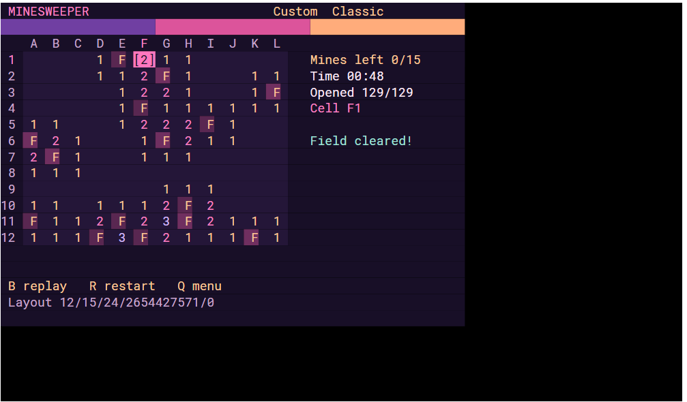

# MCU Console Games

`C / STM32F407 / Renode / Arm GCC / CMake / Doxygen`

**Три классические игры на одном STM32F407.** Соберите четыре линии одним ходом, создайте поле Сапёра и поделитесь его кодом или пройдите десять уровней Пинг-понга против компьютера.

Three terminal games in one bare-metal firmware image, with a shared pink retrowave launcher.

## Скриншоты / Screenshots

[](docs/screenshots/main-menu.png)

<table>
<tr>
<td width="33%" valign="top"><strong>Тетрис / Tetris</strong><br><a href="docs/screenshots/tetris.png"></a><br>Поле, следующая фигура и тень приземления / Playfield, next piece, and ghost piece</td>
<td width="33%" valign="top"><strong>Сапёр / Minesweeper</strong><br><a href="docs/screenshots/minesweeper.png"></a><br>Открытые клетки, координаты и счётчик мин / Revealed cells, coordinates, and mine counter</td>
<td width="33%" valign="top"><strong>Пинг-понг / Pong</strong><br><a href="docs/screenshots/pong.png"></a><br>Матч против компьютера, счёт 1:0 / Match against the CPU, score 1–0</td>
</tr>
</table>

### Возможности / Features

<table>
<tr>
<td width="50%" valign="top"><strong>Выбор сложности / Difficulty selection</strong><br><a href="docs/screenshots/difficulty.png"></a><br>Easy, Normal, Hard</td>
<td width="50%" valign="top"><strong>Очки в Тетрисе / Tetris scoring</strong><br><a href="docs/screenshots/tetris-line-clear.png"></a><br>Четыре линии и +1600 очков / Four lines and +1600 points</td>
</tr>
<tr>
<td width="50%" valign="top"><strong>Продолжение в Сапёре / Resume in Minesweeper</strong><br><a href="docs/screenshots/minesweeper-resume.png"></a><br>U continue — загрузка сохранённой партии / Restore a saved game</td>
<td width="50%" valign="top"><strong>Следующий уровень в Пинг-понге / Next level in Pong</strong><br><a href="docs/screenshots/pong-next-level.png"></a><br>Победа 5:4 и клавиша N для перехода / Win 5–4 and press N to advance</td>
</tr>
</table>

Меню и выбор сложности сняты в Renode. Игровые кадры восстановлены из вывода USART2 того же прогона. / The menu and difficulty screenshots were captured in Renode. Gameplay frames were rendered from the same run’s USART2 output. [Renode CI](https://github.com/zaordy5/mcu-console-games/actions/runs/44611936913)

## Что можно попробовать

Три игры запускаются из одного меню на STM32F407. В окне USART2 нажмите **1** для Тетриса, **2** для Сапёра или **3** для Пинг-понга. Затем выберите **Easy**, **Normal** или **Hard** клавишами `1/2/3`. Меню объясняет, что именно меняет сложность в выбранной игре. `Q` отменяет выбор или возвращает из игры в меню. Меню и игры используют общую розовую ретровейв-палитру.

### Тетрис · выстраивайте комбинации на несколько ходов вперёд

- **Поле 12 × 18 и семь фигур.** В каждом перемешанном наборе I, J, L, O, S, T и Z встречаются по одному разу. При новой партии последовательность повторяется, поэтому комбинацию можно отработать и показать на демонстрации.
- **Следующая фигура и тень приземления.** Панель `Next block` помогает спланировать следующий ход. Контур на поле показывает, где остановится текущая фигура.
- **Управление темпом.** Стрелки и WASD позволяют двигать, поворачивать и опускать фигуру на ряд. Пробел мгновенно опускает её к контуру и закрепляет. При повороте у боковой стенки игра пробует сдвинуть фигуру внутрь поля.
- **Награда за комбинации.** Заполненные ряды удаляются одновременно. За 1, 2, 3 и 4 линии за один ход начисляется **100, 400, 900 и 1600 очков** соответственно. При четырёх линиях появляется сообщение `4 LINES +1600`.
- **Сложность и рост скорости.** Стартовый шаг падения занимает 850 / 600 / 350 мс на Easy / Normal / Hard. Каждые пять очищенных линий повышают уровень и уменьшают интервал на 70 мс, до минимума 100 мс. Вверху видны счёт, уровень, число строк и текущий темп. Если новая фигура не помещается, экран сохраняет итог партии.

[Управление и готовая последовательность для четырёх линий](docs/TETRIS.md)

### Сапёр · кампания, своё поле и режим без угадывания

- **Кампания на трёх полях.** После победы `N` открывает следующий уровень. Размер растёт с **8 × 8** до **10 × 10** и **12 × 12**. Сложность отвечает за плотность мин — 12%, 18% или 25% с округлением вниз.
- **Свободная игра с выбором размера и мин.** До первого открытия нажмите `C`, выберите поле клавишами `1/2/3` и введите число мин. Можно задать от **1 до 55** мин для 8 × 8, **до 91** для 10 × 10 и **до 135** для 12 × 12. `Enter` подтверждает ввод, `Backspace` исправляет, `Q` отменяет.
- **Classic и Logic.** `G` переключает режим до первого хода. В Logic встроенный решатель проверяет, что поле можно пройти от выбранной клетки по числам и общему количеству мин. В свободной игре режим доступен при плотности до 25% включительно.
- **Безопасный первый ход.** Стартовая клетка и её ближайшие соседи свободны от мин. Открытие пустой области раскрывает соседние клетки до границы с цифрами или флажками. Первый открытый участок кратко подсвечивается.
- **Пометки и быстрое открытие.** `F` ставит флажок, который защищает клетку от открытия, а `?` отмечает сомнение. Когда число соседних флажков совпадает с цифрой, игра подсвечивает клетки, которые откроет пробел или Enter. Точность расстановки флажков остаётся за игроком.
- **Цвета и координаты помогают ориентироваться.** Двигайте курсор стрелками или WASD и открывайте клетки пробелом или Enter. У цифр разные цвета, у курсора контрастный фон, а строка и столбец подписаны координатами. Панель показывает остаток мин по флажкам, таймер, число открытых безопасных клеток и текущую координату. На экране проигрыша отдельно видны взорванная мина, другие мины и ошибочные флажки.
- **Пауза и продолжение.** `P` скрывает поле и останавливает таймер. После выхода по `Q` можно снова открыть Сапёр и нажать `U` до первого хода, чтобы вернуть поле, курсор, пометки, уровень и время. Последняя незавершённая партия хранится в ОЗУ до сброса прошивки.
- **Обмен полями и реванш.** Экран результата выдаёт код `Layout`. Его можно передать другому игроку и загрузить по `L`, чтобы сыграть на той же раскладке с той же первой клеткой. `B` повторяет раскладку и первый ход, `R` начинает новую партию.

| Поле кампании | Easy | Normal | Hard |
| --- | ---: | ---: | ---: |
| 8 × 8 | 7 мин | 11 мин | 16 мин |
| 10 × 10 | 12 мин | 18 мин | 25 мин |
| 12 × 12 | 17 мин | 25 мин | 36 мин |

[](docs/screenshots/minesweeper-custom-cleared.png)

На скриншоте открыты все 129 безопасных клеток за 48 секунд. Чтобы сыграть на том же поле, откройте Сапёр, нажмите `L` до первого хода и введите `12/15/24/2654427571/0`.

[Управление, правила Logic и пример кода поля](docs/minesweeper.md)

### Пинг-понг · победите компьютер на десяти уровнях

- **Матч до пяти очков.** Управляйте левой ракеткой клавишами `W/S` на поле 40 × 16. Цвета ракеток совпадают с цветами счёта, а пунктир обозначает середину поля. После розыгрыша игра показывает, кто взял очко, и стрелкой указывает направление следующей подачи.
- **Контроль отскока.** Попадание в центр ракетки отправляет мяч горизонтально. Верх и низ ракетки меняют вертикальное направление, поэтому траекторией можно управлять в розыгрыше. Следующая подача начинается через 600 мс.
- **Три скорости реакции соперника.** Компьютер делает шаг раз в **400 / 240 / 175 мс** на Easy / Normal / Hard. При смене сложности меняется реакция компьютера, а при переходе между уровнями ускоряется сам мяч.
- **Десять уровней.** После победы `N` начинает следующий матч на той же сложности со счётом 0:0. Интервал движения мяча сокращается с **90 мс на L1** до **36 мс на L10**. Игра проверяет столкновение на каждом шаге мяча, включая максимальную скорость. После поражения и на экране результата L10 клавиша `Q` возвращает в меню.

[Управление и проверенный сценарий победы 5:4](docs/PONG.md)

### Что сделано на микроконтроллере

Все три игры собраны в один **bare-metal ELF для STM32F407**. Прошивка опрашивает **USART2 на 115200 бод**, использует **SysTick** для интервалов падения, движения мяча и таймера Сапёра и обновляет изменившиеся участки игровой области через ANSI-последовательности. Сборка проверена в **Renode 1.17.0** на модели STM32F4 Discovery. Для всех экранов подходит ANSI truecolor-терминал от 80 × 24 символов. [Как устроена проверка](docs/INTEGRATION.md)

<details>
<summary><strong>Сборка, запуск и работа команды</strong></summary>

## Сборка и запуск

Для сборки нужны CMake 3.16+, генератор Ninja и `arm-none-eabi-gcc` из Arm GNU Toolchain. Для запуска используйте Renode 1.17.0.

```sh
git clone https://github.com/zaordy5/mcu-console-games.git
cd mcu-console-games
cmake -S . -B build -G Ninja -DCMAKE_TOOLCHAIN_FILE=cmake/arm-gcc.cmake
cmake --build build
```

Запустите `renode`. В Renode Monitor укажите абсолютные пути к ELF и профилю, затем введите `start`.

```text
set bin @C:/work/mcu-console-games/build/games.elf
include @C:/work/mcu-console-games/emulation/stm32f4.resc
start
```

Готовый ELF можно скачать вместе с `games.resc` и журналами в [артефакте проверенной сборки](https://github.com/zaordy5/mcu-console-games/actions/runs/44611936913/artifacts/14572957152). Распакуйте архив и подключите `games.resc` по абсолютному пути в Renode Monitor.

## Проверки и документация

- [Сборка, автопроверки USART2 и Doxygen](docs/INTEGRATION.md).
- [Проверенный коммит `c685eaf`](https://github.com/zaordy5/mcu-console-games/commit/c685eafb7e9744f5ef9658c8a939d5a09b5dba13) · [CI](https://github.com/zaordy5/mcu-console-games/actions/runs/44611936913) · [Независимая сборка и запуск](https://github.com/zaordy5/mcu-console-games/pull/10#issuecomment-7021876546).
- [Общий интерфейс Game](include/game.h) · [Профиль STM32F4 Discovery](emulation/stm32f4.resc).

## Работа команды

`develop` — рабочая ветка. Готовые изменения по играм отправляются в неё через pull request с проверкой участника команды. Самостоятельные правки документации можно вносить напрямую, если они не пересекаются с чужой работой. `main` содержит проверенную сборку и инструкцию для запуска. [Дорожная карта](docs/ROADMAP.md) · [Интеграция трёх игр](https://github.com/zaordy5/mcu-console-games/pull/10)

</details>

<details>
<summary><strong>English version</strong></summary>

## What you can play

One bare-metal STM32F407 firmware runs all three games with a shared pink retrowave launcher over USART2. Select a game with `1/2/3`, then select Easy, Normal, or Hard with `1/2/3`. The difficulty screen explains the setting for each game. `Q` returns to the launcher from gameplay or cancels difficulty selection.

### Tetris

- Play on a **12 × 18** board with all seven tetrominoes appearing once per shuffled bag. Each new session repeats the same sequence, so you can rehearse a setup.
- Plan with the next-piece preview and landing ghost. Use arrows or WASD to move, rotate, and soft drop. Press Space to hard drop and lock. Rotations near a side wall can shift the piece back inside the board.
- Clear 1–4 rows at once for **100 / 400 / 900 / 1600** points. A four-line clear also shows `4 LINES +1600`. The HUD shows score, lines, level and drop interval.
- Easy, Normal and Hard start at **850 / 600 / 350 ms** per row. Every five lines raises the level and shortens the interval by 70 ms, down to 100 ms. The result screen shows the final score and level when the next piece cannot spawn. [Controls and a four-line demo sequence](docs/TETRIS.md)

### Minesweeper

- **Campaign** progresses through **8 × 8, 10 × 10, and 12 × 12** boards with `N` after a win. Easy, Normal and Hard use **12%, 18%, and 25%** mine density, rounded down.
- **Custom boards** let you pick any of the three sizes with `C` before your first move and set the mine count. The ranges are **1–55**, **1–91**, and **1–135** mines, respectively.
- **Classic and Logic** are available via `G` before the first move. In Logic, the built-in solver verifies that the board can be completed from the chosen first cell. Custom Logic boards allow up to 25% mine density.
- The **safe first move** guarantees an empty starting cell and mine-free neighbors. Empty areas expand automatically, and the first revealed area briefly lights up. Use `F` for a protective flag and `?` for an uncertain cell. When a number has enough adjacent flags, the interface previews which cells Space or Enter will reveal.
- Use arrows or WASD to move, and Space or Enter to reveal a cell. Distinct number colors, highlighted coordinates and the cursor guide navigation. The HUD shows the timer, mine and reveal counts, and cell coordinates. The loss screen distinguishes the triggered mine, other mines and misplaced flags.
- Pause with `P`. Exit with `Q` and press `U` on your next visit to resume the last unfinished game, including flags, cursor and time. The save is kept in RAM until reset.
- **Share or replay boards.** Copy the `Layout` code from the results and load it with `L` to reproduce the layout and first move. `B` replays that setup and `R` starts a new game. [Controls, Logic rules and an example board code](docs/minesweeper.md)

### Pong

- Play **first to five** against the CPU with `W/S` on a 40 × 16 court. Color-coded paddles and scores identify both sides. After a point, the game shows who scored and the direction of the next serve, which starts after 600 ms.
- Use the paddle edges to deflect the ball vertically. A center hit sends it horizontally. Easy, Normal and Hard set the CPU move interval to **400 / 240 / 175 ms**.
- Win and press `N` to advance through **10 levels**. The score resets to 0–0 while the difficulty stays selected. The ball step interval drops from **90 ms at L1** to **36 ms at L10**, with collisions checked at every step. [Controls and a verified 5–4 demo sequence](docs/PONG.md)

The firmware uses SysTick for game timing, USART2 at 115200 baud, and ANSI truecolor for partial screen updates. The combined image was verified on the STM32F4 Discovery model in Renode 1.17.0. Use an ANSI truecolor terminal of at least 80 × 24 characters.

## Build and run

Install CMake 3.16+, Ninja, Arm GNU Toolchain, and Renode 1.17.0. Run the following commands from the repository root.

```sh
cmake -S . -B build -G Ninja -DCMAKE_TOOLCHAIN_FILE=cmake/arm-gcc.cmake
cmake --build build
```

Set the absolute path to `build/games.elf` with `set bin` in the Renode Monitor, include `emulation/stm32f4.resc`, and type `start`. The [verified CI archive](https://github.com/zaordy5/mcu-console-games/actions/runs/44611936913/artifacts/14572957152) also includes the ELF, a standalone Renode script, and UART logs.

See the [integration guide](docs/INTEGRATION.md) for automated checks and Doxygen. CI and an independent clean build passed on [`c685eaf`](https://github.com/zaordy5/mcu-console-games/commit/c685eafb7e9744f5ef9658c8a939d5a09b5dba13).

</details>
