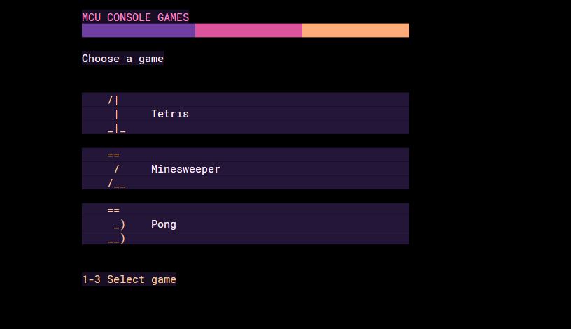
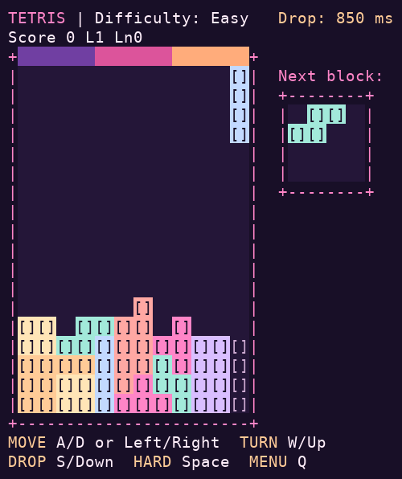

# MCU Console Games

Тетрис, Сапёр и пинг-понг против компьютера в одной прошивке для STM32F407. Клавиши и цветной экран идут через USART2. Прошивка проверена на модели STM32F4 Discovery в Renode 1.17.0.

[](docs/screenshots/menu-usart2.png)

В меню `1` открывает Тетрис, `2` — Сапёр, `3` — пинг-понг. Затем `1–3` выбирают сложность Easy, Normal или Hard. `Q` возвращает в меню.

## Игры

| Тетрис | Сапёр | Пинг-понг |
| --- | --- | --- |
| [](docs/screenshots/tetris.png) | [](docs/screenshots/minesweeper.png) | [](docs/screenshots/pong.png) |
| [Правила и сценарий очистки четырёх строк](docs/TETRIS.md) | [Правила и код для обмена полями](docs/minesweeper.md) | [Правила и сценарий победы 5:4](docs/PONG.md) |

| Игра | Управление | Easy / Normal / Hard | Следующий уровень |
| --- | --- | --- | --- |
| Тетрис | Стрелки или WASD, пробел сбрасывает и закрепляет фигуру | 850 / 600 / 350 мс на ряд | Каждые пять очищенных строк сокращают интервал на 70 мс, до 100 мс |
| Сапёр | Стрелки или WASD, пробел или Enter открывает клетку, `F` ставит флажок | 7 / 11 / 16 мин на поле 8 × 8 | После победы `N` открывает поле 10 × 10, затем 12 × 12 |
| Пинг-понг | `W` и `S` двигают левую ракетку, матч идёт до пяти очков | Соперник двигается раз в 400 / 240 / 175 мс | После победы `N` начинает матч с более быстрым мячом, до L10 |

- **Тетрис.** На поле 12 × 18 выпадают семь тетромино. Превью показывает следующую фигуру, контур — место приземления. За четыре строки одним ходом начисляется 1600 очков. [Кадр после очистки](docs/screenshots/tetris-line-clear.png)
- **Сапёр.** Первый ход безопасен. До него можно выбрать своё поле клавишей `C`, переключить Classic / Logic через `G` или загрузить раскладку через `L`. Клавиша `U` восстанавливает незавершённую партию после выхода в меню. [Пройденное поле 12 × 12](docs/screenshots/minesweeper-custom-cleared.png) · [Продолжение партии](docs/screenshots/minesweeper-resume.png)
- **Пинг-понг.** Края ракетки меняют вертикальное направление мяча. После перехода на новый уровень счёт начинается с 0:0, а интервал движения мяча уменьшается с 90 мс на L1 до 36 мс на L10. [Переход на следующий уровень](docs/screenshots/pong-next-level.png)

## Сборка и запуск

Нужны Git, CMake 3.16+, Arm GNU Toolchain с `arm-none-eabi-gcc` в PATH и генератор GNU Make или Ninja. Для Ninja добавьте `-G Ninja` на шаге конфигурации.

```sh
git clone https://github.com/zaordy5/mcu-console-games.git
cd mcu-console-games
git rev-parse HEAD
cmake -S . -B build -DCMAKE_TOOLCHAIN_FILE=cmake/arm-gcc.cmake
cmake --build build --verbose
```

Запустите Renode 1.17.0 и укажите в Monitor абсолютные пути к ELF и профилю. Замените `C:/mcu-games` на путь к своей копии.

```text
set bin @C:/mcu-games/build/games.elf
include @C:/mcu-games/emulation/stm32f4.resc
start
```

Перейдите в окно USART2. Для общего меню нужен терминал с ANSI RGB размером от 80 × 24. Установка инструментов, запуск готового ELF из архива CI, автопроверки и Doxygen описаны в [инструкции](docs/INTEGRATION.md).

## Устройство проекта

| Файлы | Назначение |
| --- | --- |
| [src/platform.c](src/platform.c), [src/startup.S](src/startup.S), [src/stm32f407.ld](src/stm32f407.ld) | USART2 (115200 бод), SysTick, запуск Cortex-M4 и размещение секций ELF |
| [src/menu.c](src/menu.c), [include/game.h](include/game.h) | Выбор игры и сложности, общий интерфейс ввода, таймера и отрисовки |
| [src/](src/) | Игровая механика и частичное обновление экрана через ANSI |
| [tests/](tests/) | Хост-тесты на C и автосценарии USART2 в Renode |

## Проверки и материалы для сдачи

- [GitHub Actions](https://github.com/zaordy5/mcu-console-games/actions/workflows/firmware.yml) публикует ELF, лог сборки, UART-журналы и отчёт Doxygen с SHA исходников.
- В [матрице критериев](docs/CRITERIA_AUDIT.md) указаны способы проверки и доказательства. В [описи комплекта](docs/SUBMISSION.md) перечислены материалы по ревизиям. Независимые проверки описаны в [отчёте QA](docs/QA_REPORT.md).
- [Кадр главного меню](docs/screenshots/menu-usart2.png) · [Кадр выбора сложности](docs/screenshots/difficulty.png)
- [Видеозаписи проекта на Яндекс Диске](https://disk.yandex.ru/d/iZFVHk75zIZLpg)
- [Сценарий записи](docs/VIDEO.md) описывает показ трёх игр и отладку GDB в Renode. Статус запуска на плате и аппаратной отладки ведётся в [задаче №4](https://github.com/zaordy5/mcu-console-games/issues/4).

<details>
<summary>English overview</summary>

Tetris, Minesweeper and single-player Pong share one STM32F407 firmware. Use `1–3` to choose a game, `1–3` to set the difficulty and `Q` to return to the launcher.

- **Tetris** includes all seven tetrominoes, a next-piece preview, a landing outline and hard drop. Clearing four rows in one move awards 1600 points.
- **Minesweeper** includes a three-level campaign, custom boards, a Logic mode and shareable layouts. Press `U` before your first move to resume an unfinished game.
- **Pong** is first to five points against the computer. Win a match and press `N` to advance through ten levels with a faster ball.

The [build commands](#сборка-и-запуск) use CMake 3.16+, GNU Make or Ninja and the Arm GNU Toolchain. Run the ELF on the STM32F4 Discovery model in Renode 1.17.0 and use an 80 × 24 truecolor terminal for USART2. See the [integration guide](docs/INTEGRATION.md) for build tools and tests.

</details>

## Источники

**Микроконтроллер и инструменты**

1. STMicroelectronics. *STM32F405xx, STM32F407xx*. Datasheet DS8626, rev. 10. Карта выводов и интерфейсы микроконтроллера. [PDF](https://www.st.com/resource/en/datasheet/stm32f407ig.pdf)
2. STMicroelectronics. *STM32F405/415, STM32F407/417, STM32F427/437 and STM32F429/439 advanced Arm-based 32-bit MCUs*. Reference manual RM0090, rev. 21. Регистры RCC, GPIO и USART. [PDF](https://www.st.com/resource/en/reference_manual/rm0090-stm32f407-advanced-armbased-32bit-mcus-stmicroelectronics.pdf)
3. Yiu, J. *The Definitive Guide to ARM Cortex-M3 and Cortex-M4 Processors*. 3rd ed., Newnes. ISBN 978-0-12-408082-9. Запуск ядра, исключения и SysTick. [Страница издателя](https://shop.elsevier.com/books/the-definitive-guide-to-arm-cortex-m3-and-cortex-m4-processors/yiu/978-0-12-408082-9)
4. Dickey, T. E. *XTerm Control Sequences*. Справочник по позиционированию курсора и последовательностям SGR для RGB-цвета. [Справочник](https://invisible-island.net/xterm/ctlseqs/ctlseqs.html)
5. Antmicro. *Renode documentation: Debugging with GDB*. Подключение отладчика к виртуальной плате. [Руководство](https://renode.readthedocs.io/en/latest/debugging/gdb.html)

**Статьи о моделях игр**

6. Demaine, E. D., Hohenberger, S., Liben-Nowell, D. “Tetris is Hard, Even to Approximate”. *COCOON 2003*, pp. 351–363. Описание модели поля, тетромино и удаления рядов. [Публикация](https://erikdemaine.org/papers/Tetris_COCOON2003/)
7. Kaye, R. “Minesweeper is NP-complete”. *The Mathematical Intelligencer*, 22(2), 9–15, 2000. Формальная модель ограничений по открытым подсказкам. [DOI 10.1007/BF03025367](https://doi.org/10.1007/BF03025367)
