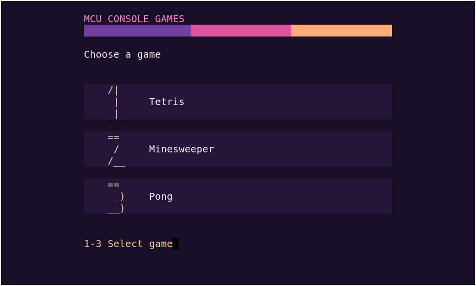
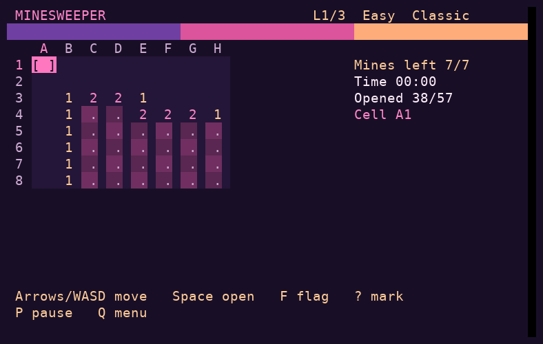
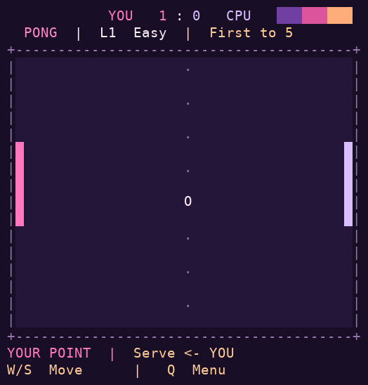
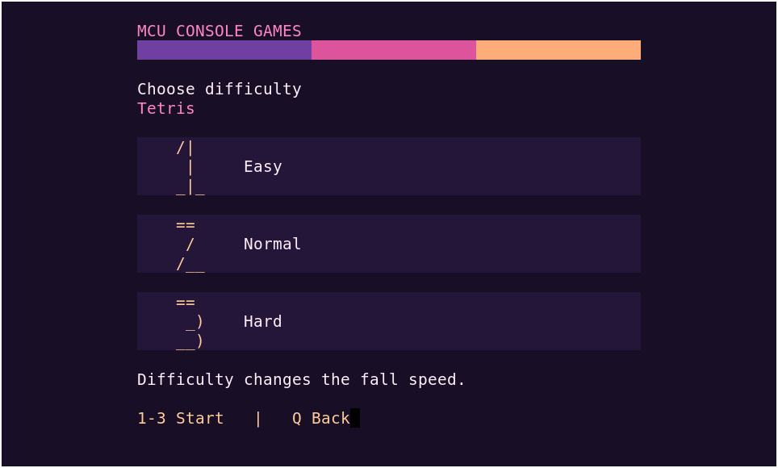
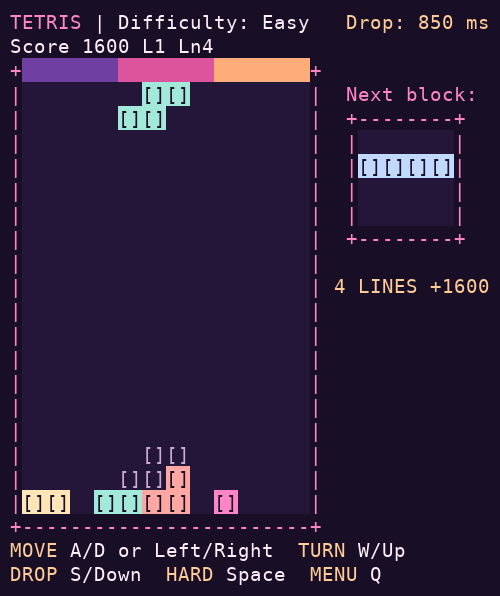
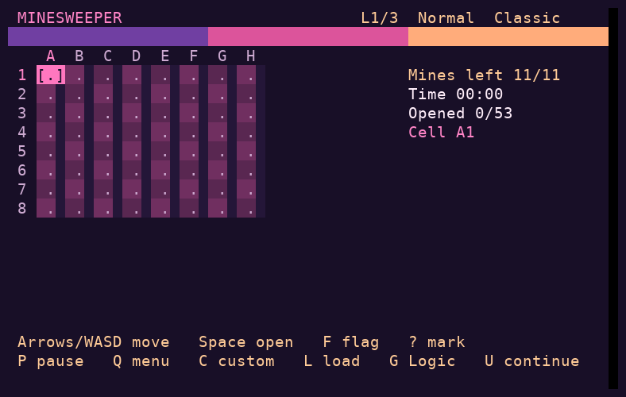
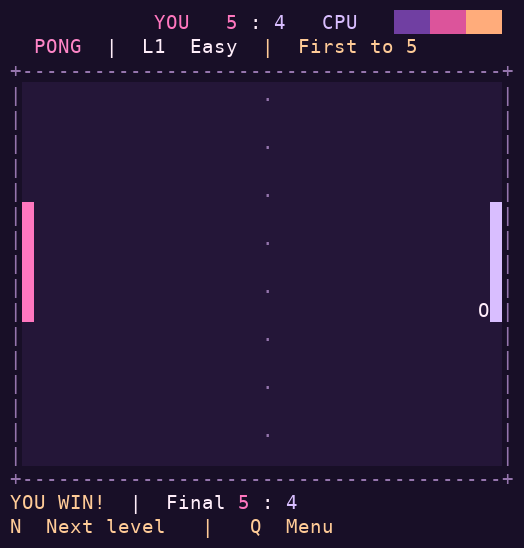

# MCU Console Games

`C / STM32F407 / Renode / Arm GCC / CMake / Doxygen`

Three terminal games running from a single bare-metal STM32F407 firmware image. The shared launcher and games use a pink retrowave palette over USART2.

## Скриншоты / Screenshots

[](docs/screenshots/main-menu.png)

<table>
<tr>
<td width="33%" valign="top"><strong>Тетрис / Tetris</strong><br><a href="docs/screenshots/tetris.png"></a><br>Поле, следующая фигура и тень приземления / Playfield, next piece, and ghost piece</td>
<td width="33%" valign="top"><strong>Сапёр / Minesweeper</strong><br><a href="docs/screenshots/minesweeper.png"></a><br>Открытые клетки, координаты и счётчик мин / Revealed cells, coordinates, and mine counter</td>
<td width="33%" valign="top"><strong>Пинг-понг / Pong</strong><br><a href="docs/screenshots/pong.png"></a><br>Матч против компьютера, счёт 1:0 / Match against the CPU, score 1–0</td>
</tr>
</table>

### Возможности / Features

<table>
<tr>
<td width="50%" valign="top"><strong>Выбор сложности / Difficulty selection</strong><br><a href="docs/screenshots/difficulty.png"></a><br>Easy, Normal, Hard</td>
<td width="50%" valign="top"><strong>Очки в Тетрисе / Tetris scoring</strong><br><a href="docs/screenshots/tetris-line-clear.png"></a><br>Четыре линии и +1600 очков / Four lines and +1600 points</td>
</tr>
<tr>
<td width="50%" valign="top"><strong>Продолжение в Сапёре / Resume in Minesweeper</strong><br><a href="docs/screenshots/minesweeper-resume.png"></a><br>U continue — загрузка сохранённой партии / Restore a saved game</td>
<td width="50%" valign="top"><strong>Следующий уровень в Пинг-понге / Next level in Pong</strong><br><a href="docs/screenshots/pong-next-level.png"></a><br>Победа 5:4 и клавиша N для перехода / Win 5–4 and press N to advance</td>
</tr>
</table>

Меню и выбор сложности сняты в Renode. Игровые кадры восстановлены из вывода USART2 того же прогона. / The menu and difficulty screenshots were captured in Renode. Gameplay frames were rendered from the same run’s USART2 output. [Renode CI](https://github.com/zaordy5/mcu-console-games/actions/runs/44611936913)

<details>
<summary><strong>Русская версия</strong></summary>

## Проект

Тетрис, Сапёр и одиночный Пинг-понг собраны в одну прошивку `games.elf` для STM32F407. Проект разработан командой для трека «Программирование микроконтроллеров». Интеграционная сборка проверена на модели STM32F4 Discovery в Renode 1.17.0.

| Игра | Возможности |
|---|---|
| **1 · [Тетрис](docs/TETRIS.md)** | Семь фигур, предпросмотр, тень приземления, уровни скорости и подсчёт очков. |
| **2 · [Сапёр](docs/minesweeper.md)** | Безопасный первый ход, флажки, уровни кампании, выбор размера поля и продолжение партии. |
| **3 · [Пинг-понг](docs/PONG.md)** | Матч до пяти очков против компьютера, три сложности и переход на следующий уровень после победы. |

В главном меню нажмите номер игры, затем `1`, `2` или `3` для выбора сложности. Клавиши вводятся в окне USART2 без Enter. `Q` возвращает в меню. Для общего экрана подходит терминал от 80 × 24 символов с ANSI RGB.

## Сборка и запуск

Для сборки нужны CMake 3.16+, генератор Ninja и `arm-none-eabi-gcc` из Arm GNU Toolchain. Для запуска используйте Renode 1.17.0.

```sh
git clone https://github.com/zaordy5/mcu-console-games.git
cd mcu-console-games
cmake -S . -B build -G Ninja -DCMAKE_TOOLCHAIN_FILE=cmake/arm-gcc.cmake
cmake --build build
```

Запустите `renode`. В Renode Monitor укажите абсолютные пути к ELF и профилю, затем введите `start`.

```text
set bin @C:/work/mcu-console-games/build/games.elf
include @C:/work/mcu-console-games/emulation/stm32f4.resc
start
```

Готовый ELF можно скачать вместе с `games.resc` и журналами в [артефакте проверенной сборки](https://github.com/zaordy5/mcu-console-games/actions/runs/44611936913/artifacts/14572957152). Распакуйте архив и подключите `games.resc` по абсолютному пути в Renode Monitor.

## Проверки и документация

- [Сборка, автопроверки USART2 и Doxygen](docs/INTEGRATION.md).
- [Проверенный коммит `c685eaf`](https://github.com/zaordy5/mcu-console-games/commit/c685eafb7e9744f5ef9658c8a939d5a09b5dba13) · [CI](https://github.com/zaordy5/mcu-console-games/actions/runs/44611936913) · [Независимая сборка и запуск](https://github.com/zaordy5/mcu-console-games/pull/10#issuecomment-7021876546).
- [Общий интерфейс Game](include/game.h) · [Профиль STM32F4 Discovery](emulation/stm32f4.resc).

## Работа команды

`develop` — рабочая ветка. Готовые изменения по играм отправляются в неё через pull request с проверкой участника команды. Самостоятельные правки документации можно вносить напрямую, если они не пересекаются с чужой работой. `main` содержит проверенную сборку и инструкцию для запуска. [Дорожная карта](docs/ROADMAP.md) · [Интеграция трёх игр](https://github.com/zaordy5/mcu-console-games/pull/10)

</details>

<details>
<summary><strong>English version</strong></summary>

## Project

The firmware runs Tetris, Minesweeper, and single-player Pong on one STM32F407 target. Renode 1.17.0 emulates the STM32F4 Discovery board. The USART2 analyzer handles keyboard input and ANSI RGB output.

| Menu key | Game | Features |
|---|---|---|
| `1` | [Tetris](docs/TETRIS.md) | Seven tetrominoes, next-piece preview, landing ghost, and speed levels. |
| `2` | [Minesweeper](docs/minesweeper.md) | Safe first move, flags, campaign levels, custom boards, and resume. |
| `3` | [Pong](docs/PONG.md) | Single-player matches against the CPU, three difficulties, and level progression. |

Select a game, then press `1`, `2`, or `3` to choose a difficulty. Use `Q` to return to the launcher. Use an ANSI truecolor terminal of at least 80 × 24 characters.

## Build and run

Install CMake 3.16+, Ninja, Arm GNU Toolchain, and Renode 1.17.0. Run the following commands from the repository root.

```sh
cmake -S . -B build -G Ninja -DCMAKE_TOOLCHAIN_FILE=cmake/arm-gcc.cmake
cmake --build build
```

Set the absolute path to `build/games.elf` with `set bin` in the Renode Monitor, include `emulation/stm32f4.resc`, and type `start`. The [verified CI archive](https://github.com/zaordy5/mcu-console-games/actions/runs/44611936913/artifacts/14572957152) also includes the ELF, a standalone Renode script, and UART logs.

See the [integration guide](docs/INTEGRATION.md) for automated checks and Doxygen. CI and an independent clean build passed on [`c685eaf`](https://github.com/zaordy5/mcu-console-games/commit/c685eafb7e9744f5ef9658c8a939d5a09b5dba13).

</details>
